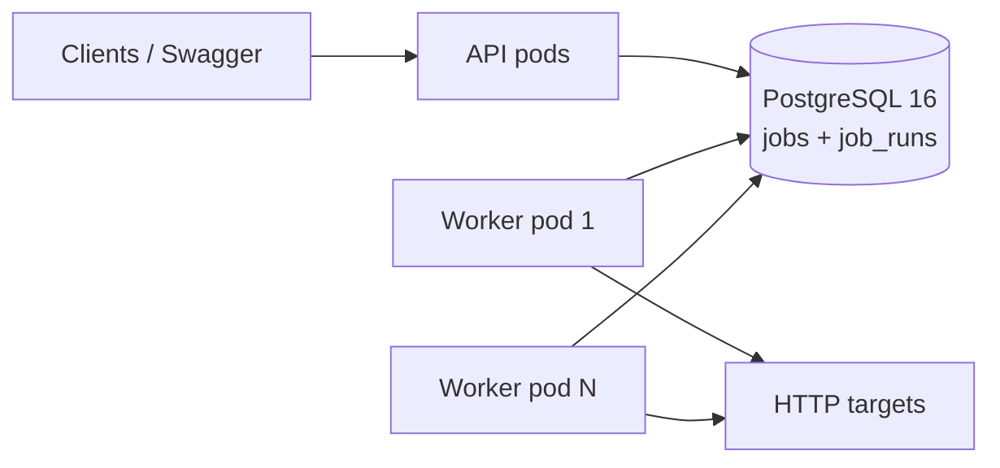

# Distributed Job Scheduler

A Java 21 / Spring Boot 3 scheduler whose stateless workers coordinate through PostgreSQL 16.
It supports cron, one-time, and fixed-rate jobs through a REST API and a pluggable HTTP executor.
No leader election, Redis, broker, Quartz, or application UI is required.



All pods use one image. SCHEDULER_ROLE selects ALL, API, or WORKER. API/worker deployments
scale separately. The implementation, failure tests, and local deployments are complete;
[verification evidence and limits](docs/VERIFICATION.md) distinguish tested behavior from
cloud/publishing work requiring your environment.

## Quickstart with Docker

Requires Docker Engine with Compose v2, Git, and Python 3 for credential/smoke helpers.
A host JDK/Maven installation is unnecessary for the Docker build. From this repository root:

```bash
# Creates random credentials in an ignored mode-600 .env; preserves any existing .env.
test -f .env || ./scripts/create-env.sh
set -a; source .env; set +a
export IMAGE_TAG="$(git rev-parse --short HEAD)"
docker compose up -d --build --wait --scale app-worker=3
curl -fsS "http://localhost:${API_PORT:-8080}/actuator/health/readiness"
```

The default topology is one API, two workers, and PostgreSQL; the command above chooses three
workers. API_PORT defaults to 8080. If 5432 is occupied, set DB_PORT=15432 and update DB_URL to
`jdbc:postgresql://localhost:15432/scheduler` in .env before loading it again. Container-to-DB
connections always use postgres:5432; DB_URL in .env is for a host-run application.
If a local Maven application already uses 8080, stop it or choose another API_PORT.

```bash
docker compose logs -f app-worker
docker compose up -d --scale app-worker=5
docker compose down
```

`down` preserves PostgreSQL data. Use `down --volumes` only to deliberately discard that stack's
local database. Keep .env out of Git and backups intended for sharing. Spring Boot does not load
.env automatically; export it in every client/host-application terminal that needs its values.

## Try the API and a successful HTTP job

Opt into the test-only HTTP receiver and explicitly allow its private Docker hostname:

```bash
set -a; source .env; set +a
export IMAGE_TAG="$(git rev-parse --short HEAD)"
export SCHEDULER_HTTP_ALLOWED_HOSTS=smoke-target
docker compose --profile smoke up -d --build --wait --scale app-worker=3
BASE="http://localhost:${API_PORT:-8080}/api/v1"
JOB_ID=$(curl -fsS -X POST "$BASE/jobs" -H "X-API-Key: $SCHEDULER_API_KEY" \
  -H 'Content-Type: application/json' \
  -d '{"name":"demo-webhook","jobType":"HTTP","scheduleType":"FIXED_RATE","fixedRateSeconds":3600,"payload":{"url":"http://smoke-target:8080/ok","method":"POST","body":"{}","expectedStatus":[200]}}' \
  | python3 -c 'import json,sys; print(json.load(sys.stdin)["id"])')
curl -fsS "$BASE/jobs?page=0&size=10&type=HTTP&name=demo" -H "X-API-Key: $SCHEDULER_API_KEY"
curl -fsS -X POST "$BASE/jobs/$JOB_ID/pause" -H "X-API-Key: $SCHEDULER_API_KEY"
curl -fsS -X POST "$BASE/jobs/$JOB_ID/resume" -H "X-API-Key: $SCHEDULER_API_KEY"
curl -fsS -X POST "$BASE/jobs/$JOB_ID/trigger" -H "X-API-Key: $SCHEDULER_API_KEY"
curl -fsS "$BASE/jobs/$JOB_ID/runs" -H "X-API-Key: $SCHEDULER_API_KEY"
```

Trigger marks the job due; it never executes in the API request thread. Repeat the history
request after a poll to see SUCCEEDED. Use a new name if repeating the create command.
The optional receiver is test tooling, not a production executor or durable idempotency store.
Swagger is at `/swagger-ui.html`; use Authorize with X-API-Key. OpenAPI is `/v3/api-docs`.

| Method | Path under /api/v1 | Behavior |
| --- | --- | --- |
| POST | /jobs | Create definition; 201 and Location |
| GET | /jobs | List/filter/paginate |
| GET | /jobs/{id} | Read definition |
| PUT | /jobs/{id} | Replace definition using current version |
| DELETE | /jobs/{id} | Delete definition/history; 204 |
| POST | /jobs/{id}/pause | Pause; repeated pause is a 200 no-op |
| POST | /jobs/{id}/resume | Activate, reset retries, recompute due time |
| POST | /jobs/{id}/trigger | Activate/reset retries, mark due using PostgreSQL now() |
| GET | /jobs/{id}/runs | Paginated newest-first history |
| GET | /runs/{id} | One execution record |

Lists return content, page, size, totalElements, totalPages. Page starts at 0; size is 1–100,
default 20. Combine status/type/name filters; name is a case-insensitive literal substring.
PUT takes the full definition plus its current version. After any active run has finished:

```bash
VERSION=$(curl -fsS "$BASE/jobs/$JOB_ID" -H "X-API-Key: $SCHEDULER_API_KEY" \
  | python3 -c 'import json,sys; print(json.load(sys.stdin)["version"])')
curl -fsS -X PUT "$BASE/jobs/$JOB_ID" -H "X-API-Key: $SCHEDULER_API_KEY" \
  -H 'Content-Type: application/json' \
  -d "{\"name\":\"demo-webhook\",\"jobType\":\"HTTP\",\"scheduleType\":\"FIXED_RATE\",\"fixedRateSeconds\":7200,\"payload\":{\"url\":\"http://smoke-target:8080/ok\",\"method\":\"POST\"},\"version\":$VERSION}"
curl -fsS -X DELETE "$BASE/jobs/$JOB_ID" -H "X-API-Key: $SCHEDULER_API_KEY"
```

All responses are records, never entities. Errors use ProblemDetail: 400 for malformed/invalid
fields, 401 for authentication, 404 for missing IDs, 409 for stale versions/duplicate names/live
lease conflicts, 413 for oversized requests, and 422 for invalid schedules/executor configuration.
Validation errors include a fields object. PUT/DELETE/resume/trigger return 409 during a live lease;
pause remains available and survives completion of the in-flight run.

## Scheduling and reliability

CRON uses six fields: sec min hour day-of-month month day-of-week, with an IANA timezone,
default UTC. Spring handles DST gaps and repeated local times. ONE_TIME uses runAt, including
past timestamps; FIXED_RATE first becomes due one interval after creation. Supply only fields
for that schedule type. A schedule edit recomputes nextRunAt; other edits preserve it and status.

Workers reserve concurrency capacity, then atomically claim due rows with UPDATE / FOR UPDATE
SKIP LOCKED / RETURNING in a short transaction. The saved owner/expiry lease lasts beyond commit;
HTTP execution holds no row lock or database connection. Heartbeats renew active ownership.
Completion checks owner, lease validity, and active run before atomically updating job/history.
Version checks also prevent stale API writes from restoring older worker/heartbeat state.
See [the class-by-class explanation and sequence diagram](docs/HOW_IT_WORKS.md).

A recurring job computes its next slot from completion time: long runs do not build an overlap
backlog. maxRetries counts extra attempts, so 2 allows up to 3 attempts. Backoff is
min(initial × multiplier^retry_count, max), then ±10% jitter. Success resets retries. Exhausted
one-time jobs become DEAD_LETTER; recurring jobs reset retries and advance to their next slot.
Timeouts record TIMED_OUT and interrupt cooperative executors. The janitor marks abandoned runs
LOST and purges old terminal history in batches of 1,000.

A job more than misfire-threshold (default 60s) late is a misfire. FIRE_ONCE_NOW runs once and
advances from completion time. SKIP advances recurring jobs without execution and completes
stale one-time jobs without a run record; explicit retries are still eligible. Shutdown stops
claims, waits for active work, then interrupts unfinished work and releases leases. Database
errors are caught with capped polling backoff; if shutdown cannot reach PostgreSQL, leases expire.

**Delivery is at-least-once.** A crash after an HTTP effect but before recording success can
repeat that effect. X-Job-Id, X-Job-Run-Id, X-Job-Attempt identify job/attempt; recovered attempts
get new run IDs. Targets needing effect-once behavior must use a stable business operation key
and durable idempotency. The Docker crash smoke deliberately demonstrates this distinction.

## Local Java development and tests

Requires Java 21, unzip (the wrapper verifies a ZIP checksum), curl/wget, and Docker access.
Check `./mvnw -v` and confirm Java 21; the POM's java.version does not switch Maven's JVM.

```bash
./mvnw verify
./mvnw -Dtest=EngineIntegrationTest,PollingResilienceTest verify
set -a; source .env; set +a
docker compose up -d --wait postgres
./mvnw spring-boot:run
```

Stop the Compose API before starting a host API on its port. On Linux, activate new Docker group
membership with a fresh login or `sg docker -c './mvnw verify'`. Tests use isolated PostgreSQL
Testcontainers and fixed test-only API keys; no .env is needed for them. Async assertions use
Awaitility. Integration tests cover two workers/500 jobs, real lease-expiry takeover, growing
retry delays/dead-letter, timeout interruption, heartbeat loss, and both shutdown outcomes.

```bash
./scripts/smoke.sh
./scripts/k8s-smoke.sh
```

Docker smoke uses an isolated three-worker project, creates 100 jobs, kills an active owner,
and asserts 100 completed jobs/100 successful runs. Observed: 1 LOST run and 101 HTTP attempts,
with 100 deduplicated receiver effects; the other 99 jobs had one HTTP attempt. It removes only
its stack/volume on exit. Override SMOKE_API_PORT/SMOKE_DB_PORT/SMOKE_TARGET_PORT if defaults
18090/15437/19091 are occupied. KEEP_STACK=1 retains the test project and private credential file.

## Kubernetes

Requires Docker, kind, kubectl (with Kustomize), Python 3, and Git. Install kind/kubectl from
their [official kind](https://kind.sigs.k8s.io/docs/user/quick-start/) and
[kubectl](https://kubernetes.io/docs/tasks/tools/install-kubectl-linux/) guides, checking checksums.
The complete local exercise builds/loads SHA-tagged images and deploys PostgreSQL with a PVC:

```bash
KEEP_CLUSTER=1 ./scripts/k8s-smoke.sh
```

It creates a fresh cluster/namespace/credentials, scales workers 1 → 5 → 1, and deletes a pod
owning a live run. Observed: 100 COMPLETED jobs, 100 SUCCEEDED runs, 0 LOST runs, 100 HTTP
attempts/effects. KEEP_CLUSTER=1 prints kubeconfig/credential paths (mode 600); otherwise it
cleans up only its own cluster/namespace. It refuses to replace an existing scheduler namespace.
Use the printed kubeconfig, then `kubectl -n scheduler port-forward svc/scheduler-api 8080:80`.

Base has separate API/worker Deployments, Service, ConfigMap, secret template, probes, resource
limits, non-root/read-only security contexts, 90s termination, PDB minAvailable=1, and CPU HPA
min=2/max=10. Local adds PostgreSQL and removes HPA for manual scaling. Prod uses a managed DB
and provider CA volume. Secret templates are excluded from apply; create real secrets first.
Kustomize namespaces apply to the complete overlay, including its added PostgreSQL resources.

```bash
./scripts/render-k8s.sh local "$(git rev-parse --short HEAD)"
./scripts/render-k8s.sh prod "$(git rev-parse HEAD)"
kubectl -n scheduler scale deploy/scheduler-worker --replicas=5
kubectl -n scheduler scale deploy/scheduler-worker --replicas=1
```

Apply rendered output only after loading/publishing that SHA-tagged image and creating secrets.
The test receiver/SSRF exception exists only in the smoke overlay. PDB protects evictions;
direct pod deletion bypasses PDB but normal deletion still honors grace. Forced crashes can
repeat attempts. CPU HPA requires metrics-server and was not load-tested locally.

For **EKS/RDS, GKE/Cloud SQL, or AKS/Azure PostgreSQL**, follow the
[managed Postgres deployment guide](docs/CLOUD_DEPLOYMENT.md), including private networking,
verified TLS, CA/Secret creation, image-pull authorization, and rollout commands. Cloud resources
were not provisioned during verification. Flyway runs on startup and takes a DB lock, allowing
concurrent pod migrations. A separate migration Job is an alternative for controlled release
ordering; the current application does not provide a migrate-only command.

## Configuration, security, and metrics

All YAML settings can be overridden through environment variables.

| Setting | Default / meaning |
| --- | --- |
| scheduler.role | ALL; API disables engine, WORKER exposes only actuator |
| scheduler.poll-interval / batch-size | 2s ±20% jitter / 20 |
| scheduler.max-concurrent-runs | 50, enforced before claiming |
| scheduler.lease-duration / heartbeat-interval | 60s / 20s; heartbeat ≤ lease/3 |
| scheduler.shutdown-grace-period | 60s; Spring phase budget 75s, pod budget 90s |
| scheduler.janitor-interval / run-retention-days | 30s / 30 days |
| scheduler.misfire-threshold | 60s |
| DB_URL / DB_USER / DB_PASSWORD | Connection supplied via env; password has no committed default |
| SCHEDULER_API_KEY | Required for API/ALL; no default; WORKER does not need it |
| SCHEDULER_HTTP_ALLOWED_HOSTS | Empty by default; explicit exact-host exceptions |

Hikari defaults to 10 connections locally; Kubernetes sets 5 per pod. Size total DB connections
for peak API/worker replicas plus rollout/admin headroom. A connection is used briefly for DB
operations, not held per HTTP run. HTTP supports method/headers/body/expectedStatus and deadline;
defaults are POST/no body/any 2xx. Responses retain at most 4 KB of UTF-8 summary.

API keys are compared as fixed-size hashes with constant-time equality. Missing/wrong/duplicate
keys return 401; public-path aliases are rejected. Actuator health/info/Prometheus remain open
for internal access. Limit their network exposure. Swagger's Authorize button supplies the key.
Payloads are capped at 64 KB serialized JSON, raw POST/PUT bodies at 128 KB, nesting at 100 levels.
Diagnostic DTOs redact payload/response bodies. Structured Logstash JSON includes scoped job/run/
node MDC on poll, heartbeat, and virtual execution threads; context is restored afterward.

SSRF protection checks every resolved IPv4/IPv6 address at validation and execution. Private,
loopback, link-local/metadata, unspecified/multicast and transition addresses are blocked; mixed
public/private DNS answers and failures are rejected. Exact-host overrides are for intentional
local/test destinations; wildcard/suffix matches are not allowed. Redirects and system proxies
are disabled. Java HttpClient resolves connections separately: these checks do not pin sockets
to DNS answers. Use network egress enforcement where rebinding-resistant guarantees are needed.

```bash
curl -fsS http://localhost:8080/actuator/prometheus
curl -fsS http://localhost:8080/actuator/health/readiness
curl -fsS http://localhost:8080/actuator/health/liveness
```

Readiness checks traffic state and DB connectivity after Flyway startup. Liveness checks only
process health. A real DB stop returned readiness 503/liveness 200; DB restart restored readiness
and polling. [Captured Prometheus output](docs/PROMETHEUS_SAMPLE.txt) shows all scheduler series.

| Micrometer name | Meaning |
| --- | --- |
| scheduler_jobs_due / scheduler_lag_seconds | Cached global due count/oldest due age, including leased jobs |
| scheduler_claim_duration / scheduler_claimed_total | Claim transaction timer / committed claims |
| scheduler_running | Active run coordinators on this pod |
| scheduler_run_duration / scheduler_runs_total | Attempt duration/count, tags type/outcome |
| scheduler_dead_letter_total | Committed local dead-letter transitions |

Timers expose `_seconds_count`, `_seconds_sum`, `_seconds_max`. Worker gauges refresh every
poll, including at capacity; API housekeeping refreshes backlog without claiming jobs. Scraping
never queries the DB; outages retain the last successful snapshot. Use max across duplicated
global backlog series, sum local running/counters, and avoid job IDs as metric labels. Increase
workers while watching lag, due count, CPU, DB pool/connection limits, and target rate limits.
KEDA/custom-metric scaling, extra executors, Helm, and tenant management are not implemented.

## CI/CD and verification status

[CI workflow](.github/workflows/ci.yml) verifies Java/Testcontainers tests and all Kustomize
variants, then runs the Docker crash smoke on GitHub runners. Actions are pinned by commit SHA.
A successful push to main additionally builds/pushes amd64+arm64 images tagged with the full
source SHA to GHCR. Java bytecode is built on the builder's native architecture. Package access
follows GitHub/GHCR permissions; production pods need pull authorization for private packages.

```bash
gh run list --workflow ci.yml
gh run view RUN_ID --log-failed
```

See [PROGRESS](docs/PROGRESS.md), [learning notes](docs/HOW_IT_WORKS.md), and
[exact verification commands/results](docs/VERIFICATION.md) for the phase history and Definition
of Done audit. The verification distinguishes normal/graceful exactly-once observations from
at-least-once crash recovery, and schema-validated cloud/HPA manifests from actual cloud rollout.
