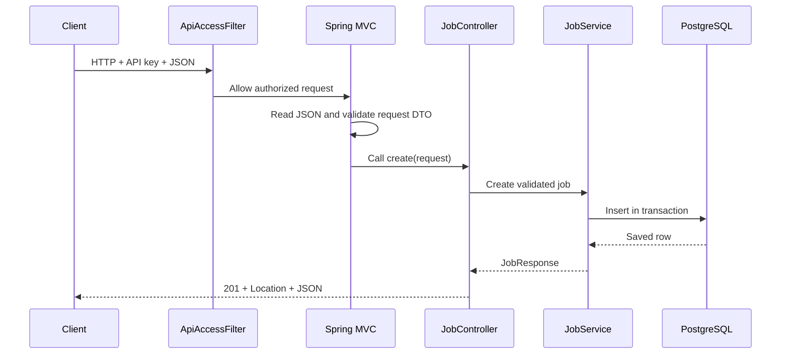

# 2. Requests, workflow, and annotations — Q&A

## What happens when I send `POST /api/v1/jobs`?



The embedded server accepts HTTP. The filter checks access and request limits. Spring MVC's
`DispatcherServlet` chooses the matching controller method. Jackson converts JSON into the
`JobRequest` record, and validation checks its annotated constraints.

[JobController](../../src/main/java/com/example/jobscheduler/api/JobController.java) delegates to
[JobService](../../src/main/java/com/example/jobscheduler/service/JobService.java). The service
validates schedule and executor configuration, computes the first due time, and saves the job.
The webhook is executed later by a worker, outside this HTTP request.

## What is an annotation? Does putting `@Something` on code execute it?

An annotation is metadata attached to a class, method, or field. A framework or tool reads it
and supplies behavior. `@PostMapping` matters because Spring MVC reads it; `@Entity` matters
because JPA/Hibernate reads it. Java's `@Override` helps the compiler check a method signature.
They are not all instructions to the same system.

## Which annotations should I learn first?

| Annotation | Meaning in this repository | Where to look |
|---|---|---|
| `@SpringBootApplication` | Configure Boot and scan the application package. | `JobSchedulerApplication` |
| `@Configuration`, `@Bean` | Declare configuration and explicitly managed objects. | `TimeConfiguration` |
| `@Service` | Register business logic as a Spring bean. | `JobService` |
| `@Repository` | Identify a persistence component; Spring can translate persistence exceptions. | `JobClaimRepository` |
| `@RestController` | Register HTTP handlers whose return values become response bodies. | `JobController` |
| `@RequestMapping` | Set a common route prefix. | `JobController` |
| `@PostMapping`, `@GetMapping` | Match an HTTP method and path. | `JobController` |
| `@RequestBody` | Deserialize the request body into a Java value. | Create/update handlers |
| `@PathVariable` | Read a route value, such as the job UUID. | Get-one handler |
| `@RequestParam` | Read query values, such as page and size. | List handler |
| `@Valid`, `@NotBlank`, `@Size` | Run/check request validation constraints. | `JobRequest`, controller |
| `@Validated` | Enable supported validation of constrained method inputs. | `JobController` |
| `@RestControllerAdvice`, `@ExceptionHandler` | Turn exceptions into consistent HTTP error responses. | `ApiExceptionHandler` |
| `@Transactional` | Establish a database transaction around a managed method call. | `JobService` |
| `@Entity`, `@Table`, `@Id` | Map a persistent Java object to a table and primary key. | `Job` |
| `@Version` | Detect conflicting updates with a version column. | `Job` |
| `@ConfigurationProperties` | Bind configuration into a typed object. | `SchedulerProperties` |
| `@Conditional`, `@ConditionalOnProperty` | Register a bean only when a condition matches. | Role/config classes |

Read [JobRequest](../../src/main/java/com/example/jobscheduler/api/JobRequest.java),
[Job](../../src/main/java/com/example/jobscheduler/domain/Job.java), and
[ApiExceptionHandler](../../src/main/java/com/example/jobscheduler/api/ApiExceptionHandler.java)
for concrete examples of the other entries.

## Why have a controller, service, and repository instead of one large class?

The controller understands HTTP, status codes, and request parameters. The service understands
job rules and state transitions. The repository understands persistence. This division lets
you test schedule rules without sending HTTP, and change HTTP representation without changing
the table mapping.

A DTO is the API contract. An entity is the persistence mapping. They can contain different
fields: database lock ownership should not become something an API caller can freely edit.
Java records suit DTOs because they are concise data carriers; records are not automatically
Spring beans or database entities.

## How does `@Transactional` work? Is it magic around every method call?

Usually Spring supplies a proxy around the managed object. A caller invokes the proxy, which
starts or joins a transaction, calls the target method, and commits or rolls back as appropriate.
With default settings, unchecked exceptions trigger rollback; checked exceptions need explicit
rollback configuration if rollback is desired.

A method calling another method on the same object does not go through that proxy again.
Likewise, constructing `new JobService(...)` yourself does not add Spring transaction behavior.
This distinction matters when moving code or writing isolated tests.

## What happens when input is wrong?

Constraint failures become field-specific validation errors. Unknown IDs return 404.
A duplicate name or conflicting version returns 409; invalid cron/timezone returns 422.
Missing or invalid API keys return 401 before normal controller handling.
The application uses `ProblemDetail` to give errors a consistent shape.

## Does a successful trigger request mean the webhook succeeded?

No. Trigger makes the job due in PostgreSQL. The API response confirms the scheduling change.
The worker later executes it. Read `/api/v1/jobs/{id}/runs` to see execution outcomes.
This separation keeps slow webhooks from occupying an API request until execution finishes.

## Try following a request

With the Docker quickstart running and `.env` exported in this terminal:

```bash
curl -fsS -H "X-API-Key: $SCHEDULER_API_KEY" \
  "http://localhost:${API_PORT:-8080}/api/v1/jobs?page=0&size=5"
```

Expected observation: a paginated JSON response, even if there are no jobs. Follow the list
method from controller to service to repository. Compare with the complete create/pause/
resume/trigger examples in the [README](../../README.md).

**Check your understanding:** Why should `POST /jobs` not call `HttpJobExecutor` directly?
Because creation and scheduled execution have different lifecycles and failure behavior.
