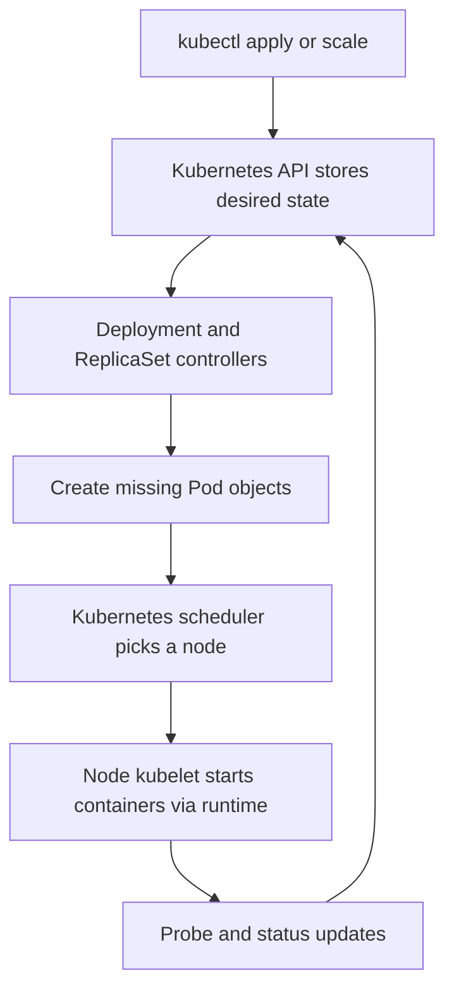

# 6. Kubernetes and orchestration — Q&A

## What does Kubernetes add after Docker?

Docker supplies container packaging and execution. Kubernetes manages desired application state
across a cluster: place workloads on machines, maintain replica counts, restart failed containers,
replace missing pods, and perform controlled updates. It does not implement our business job queue.

Our workers still coordinate through PostgreSQL. Kubernetes does not inspect `jobs` and assign
each row to a pod.

## What are a cluster, node, pod, and Deployment?

| Object | Meaning here |
|---|---|
| Cluster | The Kubernetes control plane and machines running workloads. |
| Node | A machine available to run pods. |
| Pod | A scheduled unit containing one or more containers and shared pod networking. |
| Deployment | Declares a pod template, desired replicas, and rollout strategy. |
| ReplicaSet | Maintains a replica count for a Deployment's pod template revision. |
| Namespace | A scope for grouping/naming objects, such as `scheduler`. |

Our API and worker pods each contain one application container. In local development, kind
runs Kubernetes nodes inside Docker containers. A kind node container is not one of our worker
pods; it hosts Kubernetes workloads.

## Who actually starts or replaces a worker?



Controllers repeatedly reconcile desired and observed state. If a worker pod disappears while
the Deployment still wants two, the ReplicaSet creates a replacement. If a container fails
inside an existing pod, the node may restart that container. These are different recovery paths.
Our class `SchedulerLoop` and Kubernetes' pod scheduler have different jobs despite sharing a name.

## How do requests reach an API pod?

The [API Service](../../k8s/base/service.yaml) selects API pods by labels and supplies stable
network discovery/routing to their ready endpoints. Pod IPs can change during replacements.
A ClusterIP Service is internal to the cluster; it does not automatically create a public URL.
The worker Deployment needs no business-traffic Service because workers pull jobs from the DB.

A Service doesn't retry an interrupted application operation or deduplicate webhooks. Those
behaviors belong elsewhere.

## What are ConfigMaps and Secrets?

A ConfigMap carries ordinary configuration such as polling interval. A Secret carries values
such as database credentials and the API key. Our pod environment references these objects.
The committed [secret example](../../k8s/base/secret.example.yaml) contains placeholders.

Secret values are commonly base64 encoded in YAML; base64 is encoding, not encryption.
Cluster access controls and encryption-at-rest settings still matter. Environment values in
existing pods do not automatically refresh when the referenced object changes; roll the pods
when applying configuration changes that require new process environment values.

## Why three probe types?

| Probe | Question | Effect of failure |
|---|---|---|
| Startup | Has the process reached its initial healthy state? | Allows startup time; repeated failure causes restart. |
| Readiness | Can this instance serve now? | Removes it from normal Service-ready endpoints; does not itself restart it. |
| Liveness | Is the process healthy enough to keep running? | Repeated failure causes container restart. |

Our startup probe uses the liveness endpoint. Readiness includes DB connectivity; liveness does
not. A database outage should make readiness fail without causing endless process restarts.
A worker's failed readiness does not itself pause its loop: the loop separately catches database
errors and backs off. Kubernetes readiness is not a general-purpose application pause switch.

## What do CPU and memory requests/limits mean?

Our [worker manifest](../../k8s/base/worker.yaml) requests CPU `100m` (0.1 CPU) and memory
`256Mi`; it limits CPU to 1 CPU and memory to `512Mi`. Requests guide placement and provide
resource allocation inputs. Limits constrain use: CPU may be throttled; exceeding the memory
limit can result in the process being killed. Requests are not measured application throughput.

## Why StatefulSet and PVC for local PostgreSQL?

A StatefulSet gives PostgreSQL a stable workload identity and persistent volume claim (PVC).
The volume holds data outside a replaceable container. This local single PostgreSQL instance
is not a highly available production database. The prod overlay instead connects to managed
PostgreSQL; do not horizontally scale this local StatefulSet to invent database replication.

## What is Kustomize? What is an overlay?

The [base](../../k8s/base/kustomization.yaml) holds shared resources. The
[local overlay](../../k8s/overlays/local/kustomization.yaml) adds PostgreSQL, uses one worker,
and removes the HPA for manual scaling. The
[prod overlay](../../k8s/overlays/prod/kustomization.yaml) connects to managed PostgreSQL and
keeps the baseline HPA. Kustomize combines resources and patches into ordinary Kubernetes YAML.
Rendering YAML does not deploy it.

## What happens in a rolling update?

A changed pod template, such as a new image, leads the Deployment to create replacement pods
and retire old ones according to its strategy. Our worker strategy allows one extra pod
and sets `maxUnavailable: 0`. Old workers stop claiming and attempt to finish in-flight work.
The replacement process still depends on enough cluster capacity and a healthy database.

## What is a PDB? Does it prevent every pod deletion?

Our worker PodDisruptionBudget requests at least one available worker during supported voluntary
evictions, such as a node drain. It does not prevent hardware failure, direct pod deletion,
or a deliberate Deployment downscale. It also does not implement graceful shutdown; the
process lifecycle and termination grace period handle that.

## Try rendering and inspecting

This rendering command does not need a live cluster:

```bash
kubectl kustomize k8s/overlays/local
```

Expected observation: ordinary manifests including the PostgreSQL StatefulSet and worker
Deployment. With an already deployed local stack and the correct kubeconfig/context:

```bash
kubectl config current-context
kubectl -n scheduler get deployments,pods,services,pvc
```

Use the [deployment guide](../../README.md) for image loading and real Secret setup before
applying manifests. Applying a placeholder manifest is not a complete installation.

**Check your understanding:** Who replaces a deleted worker pod, and who recovers its job?
Kubernetes replaces the pod; PostgreSQL lease expiry and another worker recover unfinished work.
