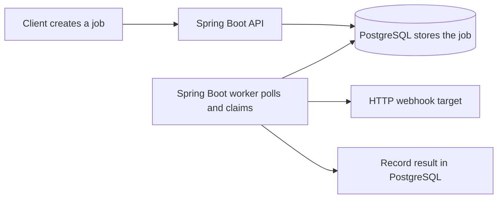

# Learn this project through questions and answers

Start here if Spring Boot, databases, containers, or Kubernetes are new to you.
These guides explain the code already in this repository. You do not need to understand
all the annotations before following a request through the application.

## Reading order

| Guide | Questions it answers |
|---|---|
| [1. Spring Boot basics](01-spring-boot.md) | What starts the app? What is a bean? Who creates the objects? |
| [2. Requests and annotations](02-requests-and-annotations.md) | Where does JSON go? What do the annotations actually do? |
| [3. Database and scheduler](03-database-and-scheduler.md) | How does Java reach PostgreSQL? How do two workers coordinate? |
| [4. Testing and smoke tests](04-testing.md) | What do the testing tools do? What does a passing test prove? |
| [5. Docker](05-docker.md) | What is an image, container, network, and volume? |
| [6. Kubernetes](06-kubernetes.md) | Who starts pods, replaces them, and routes requests? |
| [7. Scaling and recovery](07-scaling-and-recovery.md) | What happens when workers grow, shrink, or crash? |

Each guide has questions, links to actual source files, and a small exercise with an
expected observation. Run commands from the repository root. Runtime exercises assume
that you have followed the [project quickstart](../../README.md); reading the code requires
no running services. Do one guide at a time, then explain its final question in your own words.

## The story to keep in mind

Creating a job stores instructions. A worker executes those instructions later.
Docker packages the processes. Kubernetes manages their containers. PostgreSQL decides
which worker currently owns a job. These are separate responsibilities.

## Small glossary

| Word | Meaning here |
|---|---|
| JVM | The process/runtime that executes compiled Java code. |
| Framework | Code that calls your code at defined extension points. |
| Bean | An object managed by Spring. |
| DTO | A request/response data object, represented by a Java record here. |
| Transaction | A database unit of work that commits or rolls back. |
| CRUD | Create, read, update, delete. |
| Replica | Another running copy of an application component. |
| Stateless worker | A worker whose durable job state lives outside its memory. |
| Lease | Temporary database ownership with an expiry time. |
| Idempotent operation | Repeating it produces the same intended effect. |
| Orchestration | Keeping containers running according to a declared desired state. |
| Throughput | How much work completes per unit of time. |
| Latency | How long one operation takes. |

For implementation history, read [HOW_IT_WORKS](../HOW_IT_WORKS.md). For executed checks
and limitations, read [VERIFICATION](../VERIFICATION.md). These guides teach the concepts;
they do not change the scheduler's at-least-once delivery guarantee.
